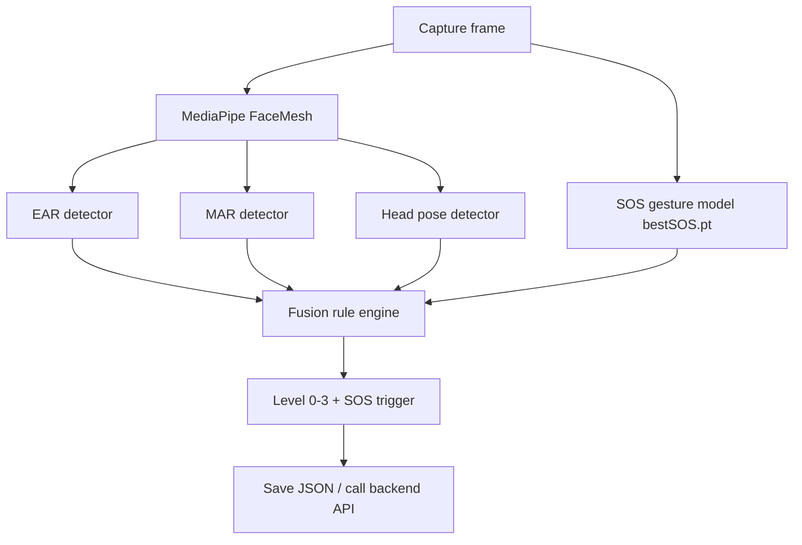

# PHAN F. Thiet ke AI engine

## 1. Module
- `eye_detector.py`: tinh EAR, smooth bang deque.
- `yawn_detector.py`: tinh MAR, smooth bang deque.
- `head_pose_detector.py`: tinh do lech vertical tu nose-chin, dung nhu pitch nhe cho MVP.
- `hand_sos_detector.py`: wrapper cho `bestSOS.pt`, uu tien Ultralytics neu model support.
- `fusion_engine.py`: rule engine hop nhat dau hieu va nang level canh bao.
- `runtime/frame_processor.py`: doc frame, trich landmark, goi detector, tra ket qua.

## 2. Luong xu ly realtime


## 3. Pseudocode
```python
while camera.is_open():
    frame = read_frame()
    landmarks = face_mesh(frame)
    ear = eye_detector.detect(landmarks)
    mar = yawn_detector.detect(landmarks)
    head_pitch = head_detector.detect_pitch(landmarks)
    sos = hand_sos_detector.predict(frame)
    state = fusion.update(FrameMetrics(ear, mar, head_pitch, sos.score, sos.stable_seconds))
    if state.level >= 2:
        post_drowsiness_event()
    if state.sos_triggered:
        post_sos_trigger()
```

## 4. Giao tiep FE/BE/AI
- FE: hien thi webcam, vi tri va trang thai giao dien.
- AI engine: chay local tren may demo, co the ghi `last_ai_state.json` hoac goi REST API len backend.
- Backend: luu lich su, xu ly SOS workflow, email, admin dashboard.

## 5. Nguong mac dinh
- `ear_threshold = 0.21`
- `mar_threshold = 0.60`
- `head_pose_threshold = 15.0`
- `eye_closed_frames_threshold = 12`
- `yawn_frames_threshold = 6`
- `head_nod_frames_threshold = 8`
- `sos_hold_seconds = 3`
