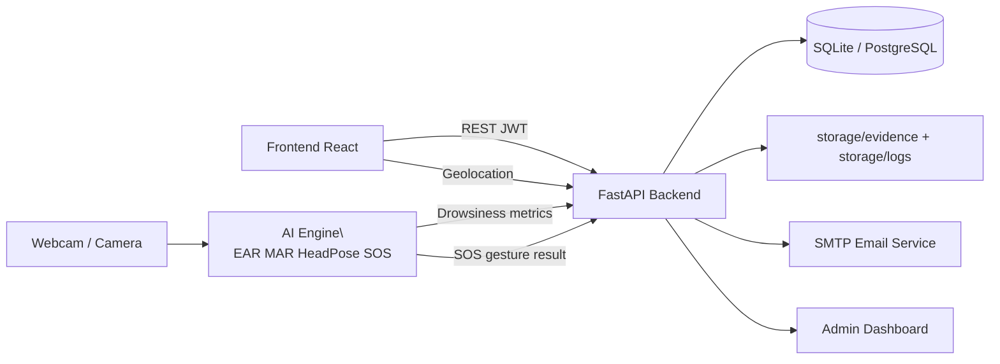

# PHAN A. Phan tich kien truc he thong tong the

## 1. Kien truc de xuat
He thong duoc chia thanh 4 lop chinh:
- Frontend web React: webcam preview, dashboard user, admin panel, trigger SOS, hien thi lich su.
- Backend FastAPI: auth JWT, profile, agencies, settings, drowsiness events, SOS workflow, email logs, audit logs.
- AI Engine Python: MediaPipe FaceMesh + OpenCV + wrapper `bestSOS.pt` + fusion rule engine.
- Data/storage: SQLite cho MVP local, co the doi sang PostgreSQL qua `DATABASE_URL`; evidence va log luu trong `storage/`.

## 2. Ly do chon cong nghe
- FastAPI: async-friendly, OpenAPI tot, phu hop backend Python.
- SQLAlchemy: ORM ro rang, de migrate len PostgreSQL.
- React + Vite + Tailwind: FE tach rieng, dev nhanh, de chia man hinh user/admin.
- MediaPipe + OpenCV: on-device inference nhanh, phu hop realtime detection.
- JWT + Argon2/Bcrypt: auth don gian, dat du cho do an tot.
- SQLite cho ban local: tao DB that ngay trong thu muc project; Postgres da san phuong an Docker.

## 3. Kien truc runtime

## 4. Quy trinh chinh
### Drowsiness
1. Frontend mo webcam.
2. AI engine xu ly frame, tinh EAR/MAR/head pose.
3. Fusion engine xac dinh level 0-3.
4. Frontend phat am thanh canh bao, backend nhan event de luu lich su.

### SOS
1. User bam nut hoac giu cu chi SOS.
2. He thong tao pending event, dem nguoc xac nhan.
3. Confirm xong se chup evidence, lay location, match agency.
4. Backend tao email, gui SMTP, ghi `email_logs`, cap nhat `sos_events`.
5. Admin theo doi va retry email neu that bai.

## 5. Bao mat
- JWT tach user/admin token.
- Mat khau bam Argon2/Bcrypt.
- Audit log cho thao tac admin.
- CCCD chi tra masked o admin list.
- Evidence luu trong `storage/evidence` va chi endpoint co quyen moi xem.
